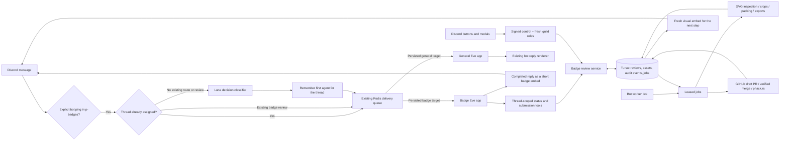
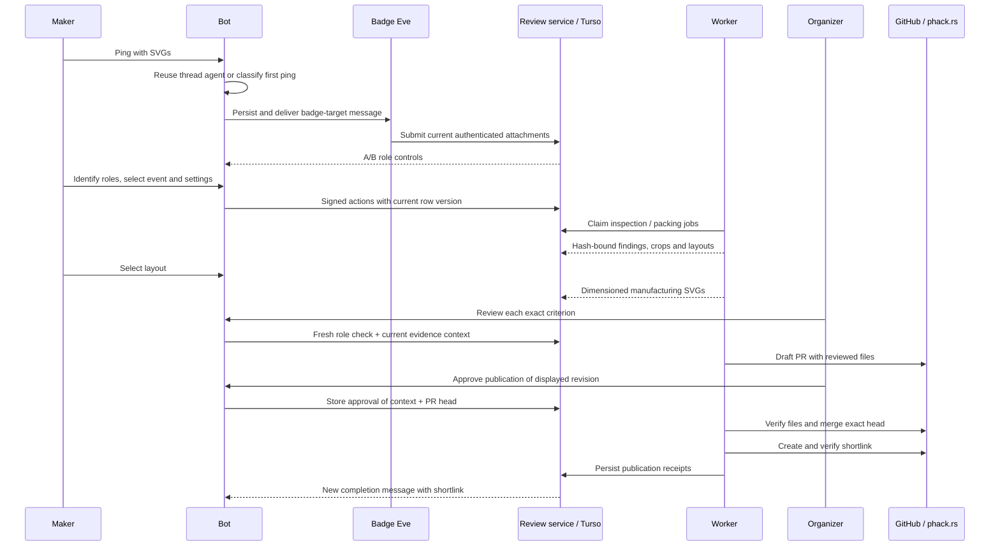

# Badge review architecture

Ping `@wack hacker` in `#p-badges` (or one of its threads) with the badge and stamp SVGs. A Luna decision chooses the badge or general Eve app for a new bot conversation. The thread keeps that agent: later pings skip classification, including design discussion before files are submitted. A thread with an existing badge review also goes directly to the badge agent. Other messages in this channel do not wake either agent. Other channels retain their existing behavior.

This feature is opt-in through `BADGE_AGENT_URL`. It does not change the Hack Night publishing/sync job.

The [current Badge and Stamp Standards](https://app.notion.com/p/purduehackers/Standards-30b181f3b6ed81af8465cebbf43f1b2e) are the rubric (checked October 12, 2026, page last edited October 3). Historical badges and stamps are not correctness references, and there is no historical import or compatibility mode. The agreed sheet inventory and 0.2-inch margins remain in effect; the standards' minimum dimensions replace the earlier experimental 1.8–2-inch range.



## Responsibilities

| Component                 | Responsibility                                                                                                                                            |
| ------------------------- | --------------------------------------------------------------------------------------------------------------------------------------------------------- |
| `packages/bot/src/badges` | Native Discord controls, fresh membership reads, visual embeds, and worker delivery after actions and on the minute. The bot keeps the Discord token.     |
| `packages/badge-agent`    | Separate Eve root application, Luna routing endpoint, authenticated workflow API, CMS and GitHub adapters. Reuses the existing Discord channel transport. |
| `packages/badges`         | Schemas, immutable evidence, deterministic workflow gates, SVG inspection, packing, physical exports, and worker dispatch.                                |
| `packages/shared`         | Shared transport target and migration for review/evidence/job storage.                                                                                    |

The badge app exposes only `review_status` and `submit_files`. File/HTTP/shell tools, generic delegation, and Eve's question tool are disabled. It has no declared subagents or model-executed publishing capability. The conversational model matches the existing Eve app; `openai/gpt-6-luna-decisions` is used only for routing. Visual review uses the human/crop path because the previous visual experiments did not justify automatic approvals.

Separate roots make routing a bot decision rather than a request for the general model to delegate. Both roots share the existing delivery queue, but have separate Eve session namespaces. `agentTarget` travels with the durable delivery, holder, rendered reply, steer, and reset. Cross-agent messages wait in the queue rather than being folded into or cancelling another agent's request. A reset cannot cut through another agent's active turn.

Redis retains the thread's initial agent choice without a TTL, so a bot restart, quiet period or Eve session reset does not trigger another classifier call. Concurrent first pings converge on the first stored choice. Badge follow-ups still register each bot-observed attachment message for submission; skipping classification does not skip evidence collection. Start a separate conversation to choose another agent.

## What people see

1. The author submits two SVGs. The bot creates or uses the Discord thread. The badge agent registers only that message's bot-observed attachments.
2. A new message asks “Which one is the badge?” with **A** and **B** previews. A one-file revision asks “Which file should this replace?” with badge/stamp buttons. The role policy stays internal.
3. Static failures name the affected file and a concrete fix. The conversation omits rule IDs and internal classifications. Unsupported SVG features still block progress internally. New exports must clear those findings.
4. After the SVG checks pass, the author chooses a CMS event and confirms badge material, badge size range, stamp size, mirroring, and cut spacing. The event ID is stable identity; version is a string extracted from `Hack Night X.XX`, and expected date is the event's Indianapolis local date. Event refresh reopens affected review work.
5. The worker offers up to three audited layouts. Defaults: one 12×12-inch sheet plus one 12×18-inch sheet, 0.2-inch edge margins, 0.5 mm cut spacing, 80–100 badges, and a 2–2.7-inch longest-side range. Both cut dimensions are displayed. The longer side must be at least 2 inches and the shorter side at least 1.7 inches, including unusual shapes. The author can enlarge the range; the worker will report failure rather than shrink below the standards to meet the batch target. Selecting a layout prepares dimensioned badge and stamp SVGs, including the requested stamp mirroring.
6. The bot asks an organizer to check **version**, **date**, **physical readability**, and **stamp**, one at a time. Each fresh embed contains that question and labeled previews. Badge reviews show the full image and a single sheet of four close-ups, preserving the resolution of each crop. The feedback form offers **Looks good**, **Needs a change**, and **Hard to tell**, with no preselected answer. The latter two require a short note. A change request pauses progression and posts the reviewer's fix. Inspection instructions stay in the form. These labels map to the existing approve / changes / unclear decisions; the underlying evidence and gates are unchanged.
7. Once all criteria pass, the worker creates or updates a draft PR in `purduehackers/badge-designs`. The organizer who completed the last criterion gives the separate **Publish** confirmation beside the repository link. This preserves a single final reviewer in the requested public metadata.
8. The worker rereads the CMS, verifies every expected repository file at the approved head, checks the PR's changed paths, and merges that exact head. It creates `phack.rs/badge-<version>` and verifies the live redirect before reporting completion.

Each meaningful step is a fresh embed at the bottom of the thread; previous messages are never rewritten. Successful button actions are acknowledged without extra “recorded” replies and trigger delivery immediately. Remaining background work runs on the minute. Delivery receipts coalesce queued updates for an already-posted version, and retries use a stable nonce for that review/version. Older controls are rejected.

All bot-authored badge replies, notices and form errors use embeds. Candidate badge pings show the native typing indicator while routing. The badge renderer sends only the completed reply, never streamed prose, tool activity or the shared diagnostic footer. It uses a lease, nonce and checkpoint receipt so retries converge on the same message. The assistant usually replies in one or two short sentences and reads the durable record first; its own narrative cannot satisfy a gate. New badge sessions receive maker comments as lead-in, excluding old bot status reports; explicit reply context is still retained.

Guidance describes actions in a design app: outline lettering, change artwork to grayscale, simplify effects or repair the cutting outline. Internal errors are mapped to a next action instead of printed. The final display boundary filters code, diagnostics and status glyphs from model prose and reviewer notes. Dates use everyday wording, dimensions use rounded inches, stamp direction is a labeled choice, and finished files have view/download buttons. SVGs uploaded by people may still receive Discord's native attachment preview; the bot's own previews are rendered PNGs.



## Evidence and failure handling

- `badge_reviews` stores a versioned current record. Updates compare the previous row version; `badge_events` records the actor and resulting snapshot in the same transaction as job creation.
- Originals, previews, crops, layouts and exports are addressed by SHA-256. Each static finding must reference the current asset hash. The human decision context includes both assets, CMS snapshot, settings, selected layout, manufacturing outputs and rubric version.
- Replacing an SVG, changing the event or settings, or choosing another layout invalidates the relevant derived evidence and human approvals. Workers check the generation and compare the row version before saving. An obsolete job cannot promote a newer revision.
- Job claims have a lease. A lost process can be recovered after lease expiry. Reported failures require an explicit retry; an expired signed attachment URL requires a fresh upload. A successful database event is deduplicated on retry.
- Final approval locks revisions during publication. GitHub writes are based on the expected branch and exact reviewed bytes; an unexpected branch edit stops publication. A retry after a lost merge response reads GitHub's merge receipt instead of merging again. An existing unrelated shortlink is never overwritten. The review remains incomplete until the redirect is observed live.
- Repository edits are not automatically trusted or imported. Reattach changed SVGs in a new review thread to run the evidence checks again. Discord submissions maintain Git commit history; this first integration deliberately does not include a GitHub webhook/import workflow.
- Only authenticated bot requests can reach workflow endpoints. HMAC controls are bound to review ID, row version and displayed action; the service also checks thread, server, author and organizer role. The bot fetches current membership for every mutation. The model cannot supply arbitrary attachment URLs, acting users, or approval decisions.

## SVG and packing limits

SVG input is capped at 1 MB, 5,000 elements, bounded nesting and viewport aspect ratio. External resources, scripts, raster images, entities, reusable linked objects and stylesheets are rejected. Plain paths, groups and basic vector primitives are supported. Live text, non-red engraving strokes, invalid palettes and unknown presentation effects block progress. Cutting currently requires one closed, unfilled red exterior path made of lines, quadratic or cubic curves. Compound outlines, multiple cuts and arcs need a plain-path export. Red cut strokes are the exception to the filled engraving rule.

The search uses no-fit polygons, a bounded rotation set, and five descending size samples. Coarse geometry is padded conservatively; a separate finer-contour audit checks every pair and sheet edge. It is a useful heuristic, not a global optimum certificate. Complex cut contours and time-budget exhaustion produce actionable failures rather than unchecked exports. Human physical review is still required for thin engraving, weak bridges, pale grayscale, disconnected art, and actual laser/material behavior. Stamp cutting is a separate job.

Evidence is stored as bounded base64 artifacts in Turso for this integration; Vercel Blob is not required. The asset store boundary can later be replaced with Blob without changing review hashes or public metadata. This version has no automatic evidence retention/garbage-collection policy.

## Published files

```text
badges/<version>/
  badge-source.svg
  stamp-source.svg
  badge.svg             # dimensioned single badge
  stamp.svg             # dimensioned, explicitly mirrored or unmirrored
  badge.png
  stamp.png
  12x12.svg
  12x18.svg
  metadata.json
  README.md
```

The shortlink points to this directory on the repository's default branch so later approved revisions remain available at the same link. GitHub's commit history and internal publication receipt retain the exact revision. The public metadata contains only:

```json
{
  "cms": { "id": "<id>", "slug": "<slug>" },
  "author": { "id": "<id>", "username": "<username>" },
  "reviewer": { "id": "<id>", "username": "<username>" }
}
```

The README contains only the Hack Night title, Badge image/download, and Stamp image/download. Event date, settings, decisions and internal evidence remain in the review database.

## Deployment

1. Apply the additive shared database migration through the existing migration workflow.
2. Deploy `packages/badge-agent` as a **separate Eve app/project**, with its own Eve session storage namespace. Keep bot supervision disabled there. Reuse the transport secrets, bot endpoint, shared Redis and shared Turso; configure read access to CMS, the GitHub App's contents/PR access to `purduehackers/badge-designs`, and `VERCEL_API_TOKEN` for phack.rs. AI Gateway access must include the Luna decision model. Allow at least 90 seconds for the worker route. The build externalizes the native SVG renderer for tracing into the hosted output.
3. Deploy the updated gateway image, then set `BADGE_AGENT_URL` in the gateway and the general app's supervisor environment. Missing URL means the existing bot behavior stays enabled and badge work stays off.
4. Exercise a real submission in a designated thread before broad use. Local validation does not prove live Discord permissions, model availability, CMS credentials, GitHub branch protection, redirect propagation or laser output.

The implementation follows the installed Eve 0.31.3 documentation (`node_modules/eve/docs/`) on root/subagent isolation, durable channel delivery, default-tool disabling and replay-safe inline tool executors. Workflow gates are ordinary service code and database transitions; Eve's model-authored experimental Workflow tool is not the business state machine.
