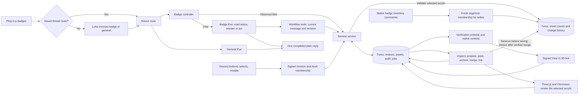
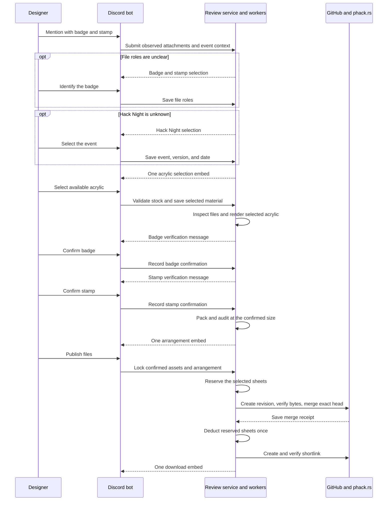

---
meta:
  contentType: Conceptual
---

# What happens after you submit a badge?

Mention wack hacker in #p-badges with your badge and stamp as Scalable Vector Graphics (SVG) files. Choose the Hack Night and acrylic, check your designs, then arrange your badges. Each step uses one message with native Discord controls. Questions receive short, plain replies.

**Automatic verification** lists file checks with ✅ or ❌. If a check fails, that same embed shows the repair guidance and design preview. Missing or uncertain evidence says “Not verified.”

Once the file checks pass, **Manual verification** appears beside the automatic results with your preview and expected details. Confirming your design changes only the manual result. Uploading a revision preserves the previous file’s findings and removes its button.

If the Hack Night is unknown, choose it before selecting acrylic. This card contains only the event question and menu. File checks run after both selections. A revision keeps the selected event and acrylic, then shows updated results in the verification card. The old failed card says **Previous verification**; its findings describe the earlier file.

Completed steps remove every button and update the title to record the result. **✅ Badge Selected** labels the preview with filenames and Badge or Stamp. **✅ Hack Night selected** shows the event and date. **✅ Acrylic Selected** names the chosen acrylic and thickness. Yellow means a step needs input or is running, green means it completed, and red means something needs fixing. Opening an upload dialog leaves the card active until you submit a file.

## The workflow steps

The bot asks for missing details before checking your files:

1. **Which one is the badge?**: Identify the badge and stamp if your message leaves their roles unclear.
2. **Choose a Hack Night**: Select the event if your message or saved selection does not identify it.
3. **Choose your acrylic**: Select available material from the Discord menu. The preview and cutting sheets use this choice.
4. **Verify your badge**: Read the automatic checks, then double-check the version, date, readability, and strength. Select **Confirm badge**.
5. **Verify your stamp**: Read the automatic checks, then check the finished impression and dimensions. Select **Confirm stamp**.
6. **How many badges?**: Choose a calculated count or enter a custom target. Each choice shows the count on each sheet.
7. **Ready to publish**: Check the exact quantity on the cutting sheets. Select **Publish files** or **Change quantity**.
8. **Get the files**: Download your saved designs and sheets through `phack.rs/badge-{version}`.

If you need to change a design, select **Upload revised badge** or **Upload revised stamp**. Each button opens Discord’s native file upload modal directly. You don’t write feedback to yourself or wait for a separate reviewer.

A stamp revision preserves your badge confirmation. If you cannot read an image, open it at full size before deciding whether to revise it. Uncertainty alone does not require a revision.

## How the bot fills in the details

You only answer questions the submission leaves unresolved. The bot uses these sources:

- **Event**: An explicit Hack Night version or event link, then the saved thread selection. A native event selector resolves ambiguity before acrylic selection. The content management system (CMS) supplies the exact version string and Indianapolis date.
- **File roles**: An explicit order such as “badge first, stamp second,” a requested replacement slot, or a role-specific upload button. Otherwise, one A/B image asks which design is the badge. Filenames do not assign roles.
- **Missing file**: One upload button asks for the missing badge or stamp. A requested revision from the original designer works without another mention.
- **Material**: You select available acrylic before the preview. The bot checks that matching sheets exist and uses the same material throughout.
- **Production settings**: Bot configuration supplies badge size, thickness, spacing, and sheets. Designers do not fill out a manufacturing questionnaire.

A mention replying to your own submission can use its attachments. A later explicit event reference can update the review’s event. Dates and versions apply to the badge, not the stamp.

## How chat reaches the workflow

The first mention in an unassigned #p-badges conversation calls `openai/gpt-6-luna-decisions` to choose the badge or general assistant. Redis stores the choice. Established threads and existing badge reviews bypass classification, including after restarts or Eve session resets.

The [Eve agent framework](./system/eve-policy-and-integrations.md) hosts the badge assistant separately. The controller handles uploads before starting an agent turn. Eve reads `review_status` before acting. Its tools identify files, select material and events, confirm designs, request revised uploads, set quantities, retry steps, and publish files. Every action calls the same controller as Discord controls. Preview and download requests return current links.

Chat actions require the bot-observed message, authenticated sender, thread, and current revision. Each message can change the workflow once. Questions do not authorize actions. Publication requires an explicit request after both confirmations and a selected quantity. A completed agent turn wakes the workflow worker; the scheduled sweep recovers missed delivery.

The architecture separates conversation, decisions, and delivery:

Both assistants use the existing [conversation delivery queue](./system/conversation-engine.md). In #p-badges, replies appear after completion without streamed prose or tool activity. The bot suppresses link previews in these replies. Requests for human input retain native controls; workflow uploads produce no separate agent acknowledgement.

## What your confirmation covers

A design confirmation identifies that design’s bytes, relevant event details, configured size, material, and current standards. Automatic resizing during arrangement preserves that confirmation. **Publish files** confirms both designs, the final dimensions, manufacturing exports, and the selected arrangement.

These changes reopen only the affected work:

| Change                                                             | Step that must run again                                          |
| ------------------------------------------------------------------ | ----------------------------------------------------------------- |
| Badge SVG, event details, configured badge size, or badge material | File preparation and badge confirmation, then arrangement         |
| Stamp SVG                                                          | File preparation and stamp confirmation, then arrangement         |
| Positions, rotations, or spacing                                   | Arrangement audit and publication confirmation                    |
| Automatic resizing to fit the target quantity                      | File preparation and arrangement, preserving design confirmations |
| Stamp source unchanged                                             | Existing stamp confirmation remains valid                         |

Permissions and revision checks run before a modal opens and again when it submits. Only you, as the original designer, can identify, replace, confirm, or publish your files. You don’t need an organizer role. Organizers can still help with event selection, configuration, and retries.

Public metadata keeps the agreed `reviewer` field, which records you when you select **Publish files**. This field does not require a separate reviewer. Internal approval fields and signed action names stay compatible with existing records; audit records retain each confirmation.

The service rejects stale controls privately and includes a jump to the latest message. Delivery replaces the previous card’s controls before acknowledging the new message. Failed edits retry; deleted cards do not block the next step. Optimistic row versions reject competing mutations. Immutable assets and queued jobs live in the [Turso database](./system/storage-supervision-and-operations.md). Expiring job leases allow recovery; delivery receipts and stable Discord nonces deduplicate normal retries. Discord does not guarantee deduplication after its nonce window expires.

## Why arrangement comes after confirmation

File inspection and physical preview preparation run before either confirmation. Packing starts only after you confirm both designs. It rotates and positions your badge, and may scale it within configured limits to fit your target quantity. The arrangement card shows the final dimensions.

The badge embed combines the full flat artwork and an angled 3D preview. The renderer adapts the extrusion, engraving overlay, and acrylic presets from [Purdue Hackers’ badge viewer](https://github.com/purduehackers/badges/tree/8598f7513f993f30389470c85b88427db46256f1). It uses the physical cut contour and your selected acrylic and thickness. The card names the material; use the flat artwork to check fine details.

The renderer runs after SVG checks pass, in a fresh Chromium process with network requests blocked. A bounded render produces a stored PNG before the badge card appears. A failed render offers the existing retry action. The preview does not simulate engraving depth, laser kerf, or material strength.

**View in 3D** opens the same design and selected material in an interactive viewer. You can rotate, zoom, and reset the view. The link signs the exact asset, material, and thickness; anyone with the link can view that asset. The page bundles its scripts, blocks external resources through its Content Security Policy, and sends no referrer. Rotating the ingress secret invalidates earlier viewer links.

[Material inventory commands](./badge-inventory.md) track whole sheets. Guild members can read counts; organizers can add sheets, record other use, or correct a count. The material menu offers acrylic with available 12 × 12-inch and 12 × 18-inch sheets at the configured thickness. The arrangement allocates your selected material to its occupied sheets. If stock runs out, it stops rather than substituting another acrylic. Publishing reserves those sheets, then deducts them after GitHub verifies the saved files.

Each transaction saves who changed the count and prevents duplicate deductions. Reserved sheets cannot serve another publication or manual use. Stamp rubber remains manual because the stamp export does not define whole-sheet consumption. Inventory does not change the configured badge size or sheet geometry.

The sequence keeps intermediate jobs silent:

Production settings live in [`policy.ts`](../packages/badges/src/policy.ts). The current defaults are a 2.2-inch badge long side, acrylic, and 0.2 mm between cuts. Exact event versions can override the badge size for unusual geometry. Sheets remain one 12 × 12-inch sheet and one 12 × 18-inch sheet, with 0.2-inch edges. The quantity step offers 80, 100, and the found capacity when those counts fit, removing duplicates. Smaller capacities offer a single-sheet count and the found total. Custom targets accept 1–500 badges.

The stamp always measures 1.5 inches on its shortest side and keeps its aspect ratio. A 3:1 stamp therefore measures 4.5 × 1.5 inches. The designer supplies unmirrored artwork. The review shows its unmirrored impression; the manufacturing export mirrors it once. Stamp material is separate from the badge sheets.

Packing uses a bounded rotation search and a separate contour audit for overlap, spacing, and edges. Each default shows a per-sheet calculation from actual placements. Selecting a count creates exactly that many cutting outlines; publishing deducts only the sheets used.

A larger target searches smaller sizes in 0.05-inch steps, down to the configured 1.8-inch minimum. Long-design size exceptions stay fixed. Automatic resizing preserves both design confirmations, updates the cutting files, and shows the final dimensions on the arrangement card. It does not repeat verification. If the search falls short, it reports the found count and keeps publication blocked until you choose a feasible quantity. The search does not prove a mathematical maximum.

An organizer can adjust configuration and select **Check again**. A changed size requires you to check and confirm the badge again. The search does not prove optimality or impossibility.

## What the checks establish

Current [Badge and Stamp Standards](https://app.notion.com/p/purduehackers/Standards-30b181f3b6ed81af8465cebbf43f1b2e) govern artwork. The stamp sizing and workflow rules above apply the approved production policy. Historical badges do not establish correctness, and this integration has no historical import mode.

**Automatic verification** lists six results tied to the current SVG: supported features, vector artwork, outlined lettering, engraving fills, palette, and one closed red cutting outline. The version, date, readability, and strength remain your checks in **Manual verification**. Red cutting strokes are the exception to filled artwork. Inputs are limited to 1 MB and 5,000 elements. Scripts, external resources, raster images, entities, linked reusable objects, and stylesheets are rejected.

The cutter supports an exterior path with lines, quadratic curves, or cubic curves. Arcs and compound cuts require a plain-path export. You check visual details, contrast, thin connections, artwork containment, and stamp clarity in the full previews. The model cannot confirm a design for you; passing checks does not prove material strength or laser performance.

## How publication recovers

**Publish files** locks the selected revision. The worker checks current event and production settings, creates a GitHub pull request, and records its exact head. It verifies file bytes and changed paths, merges that head, and reads back the saved files before recording the merge receipt.

A separate job creates and verifies the live shortlink. Badge URLs use Vercel project redirects because Global Config keys cannot contain the version's dot. The job stages one path, verifies that existing redirects are unchanged, checks the current version again, and promotes the verified content. It refuses unrelated staged changes or an occupied path. The ordinary `/phack` command continues to use Global Config.

If that job fails, the embed says the files are saved and offers **Retry link**. Retrying uses the stored receipt and does not merge again. Existing unrelated shortlinks are never overwritten.

An event change before merging releases the selected sheets. An uncertain GitHub response keeps them reserved until a retry resolves it. If GitHub already merged the exact files, retry verifies that receipt and deducts stock once, even after an event change. The stock deduction and its audit receipts share one transaction.

New revisions can start in the same thread after publication. The previous public files remain available while the new revision is reviewed. Each publication generation gets its own branch and consumes its selected sheets once. Use the manual inventory commands to return unused sheets from a replaced revision. The shortlink points to the version directory on the repository’s default branch; Git history retains earlier revisions.

The directory includes original SVGs, physical SVGs, PNG previews, both sheet layouts, and metadata. Public metadata contains exactly `cms: { id, slug }`, `author: { id, username }`, and `reviewer: { id, username }`. The README contains the Hack Night title, badge image and download, then stamp image and download.

## When the feature is enabled

The bot enables this integration only when `BADGE_AGENT_URL` is configured. Deployment requires the separate badge Eve app, its own session namespace, the additive database migration, and CMS, GitHub, phack.rs, and model credentials. The badge app shares the existing Redis and Turso infrastructure. It stores bounded assets in Turso without requiring Vercel Blob.

For local Discord testing, set `BADGES_CHANNEL_ID` to the test channel in both processes. The default remains #p-badges. The publication token needs access to project redirects on the existing phack.rs Vercel project.

The worker endpoint needs a 90s request timeout. The bot drains queued work after interactions and on its minute schedule. Typing indicators cover interactive work; only actionable states produce messages. The native SVG renderer and Chromium remain external build dependencies. The badge app’s build command builds the Three.js scene into the renderer bundle first.

For local macOS development, set `BADGE_CHROMIUM_EXECUTABLE_PATH` to a Chromium executable. Rendering launches a fresh headless profile. Linux deployments use the pinned Chromium package and its software rendering libraries. Apply both inventory migrations, register the slash commands, and enter actual stock before accepting new cutting layouts.

Offline validation covers designer confirmations without organizer roles, plain question replies, direct revision uploads, and the five-message workflow. It also covers material selection, current-file evidence, ownership, stale controls, competing decisions, stamp dimensions, packing limits, and partial publication. Changing acrylic requires badge confirmation again; unavailable stock never causes a material substitution.

A local run in #p-wack-hacker completed designer confirmations, a plain question reply, the interactive viewer, GitHub publication, the live shortlink, and inventory deduction. It used an unpublished Hack Night 0.0 event with local Redis and libSQL. A subsequent revision verified material selection, the six passing checks, and red acrylic in the preview and viewer. This revision has not been deployed.

A [new verification thread](https://discord.com/channels/772576325897945119/1559651097570840680) exercises a failed palette check, corrected upload, both confirmations, and arrangement. Discord retains both embeds, updates only the manual status, and replaces completed controls. Production won the initial thread creation race; the local test continued with the original submission. This run stops before publication without deducting inventory.
