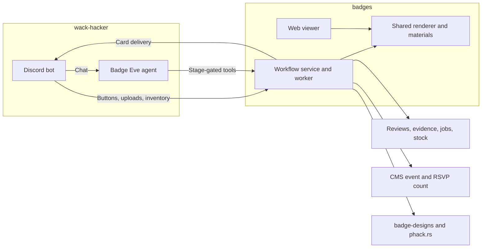

---
meta:
  contentType: Conceptual
---

# How does Wack Hacker help finish badges?

As a designer, you upload the badge and stamp, choose acrylic, and confirm both previews. Automatic checks run without success messages. A manufacturer then chooses a quantity, checks the arrangement, and publishes the files.

## What you see in Discord

Each step uses one embed with native buttons, menus, or upload dialogs. Questions receive short plain-text answers. Completed cards record the result and remove their controls.

The workflow has six stages:

- **Design**: Upload both SVGs and choose acrylic. Resolve file roles and the Hack Night only when the submission leaves them unclear.
- **Automatic quality assurance**: Failed checks show the affected design and repair guidance. Passing checks lead directly to the previews.
- **Human quality assurance**: Check the badge’s version, date, readability, and thin connections, plus the stamp’s finished impression. Choose **Confirm designs** when both look right.
- **Attendance estimate**: The designer or an organizer chooses the number to make. The agent can read RSVP counts as planning evidence.
- **Packing**: Check the actual count and dimensions. Asking “How many at 3 inches?” calculates a separate proposal without changing the batch.
- **Publication**: Choose **Publish cutting files** to save exports, create the share URL, and deduct the acrylic sheets once.

The stamp measures 1.5 inches on its shortest side. The designer uploads it unmirrored; the service mirrors its cutting export. Production settings come from configuration, and quantity changes do not repeat human quality assurance.

## Which repository owns the work

The [badges repository](https://github.com/purduehackers/badges) owns the workflow, materials, 3D scene, web viewer, inventory, and publication. Wack Hacker owns Discord routing, authenticated transport, embeds, controls, and Eve’s conversational agent. [badge-designs](https://github.com/purduehackers/badge-designs) stores published assets.

This diagram shows the request paths:

The first ping in an unassigned #p-badges thread uses Luna to choose the badge or general agent. Saved thread routes bypass classification. Both agents use the existing [Discord conversation engine](system/conversation-engine.md); badge work does not add Eve HTTP channels.

## What the badge agent can do

Eve refreshes `tools/catalog.ts` before every model step. The badge service returns only actions that the current person can perform at the current stage. Native Discord interactions call the same controller checks.

The tool groups match the work:

| Stage            | Tools                                                                             |
| ---------------- | --------------------------------------------------------------------------------- |
| Any stage        | `get_review`                                                                      |
| Design setup     | `identify_files`, `select_event`, `select_material`                               |
| Design checks    | `confirm_design`, `request_replacement`, `keep_design`                            |
| Production       | `estimate_attendance`, `set_target_quantity`, `preview_packing`, `select_packing` |
| Ready to publish | `publish_batch`                                                                   |
| Error            | `retry_failed_step`                                                               |
| Organizer        | `inventory`                                                                       |

Tools require the current bot-observed human message and review revision. Only the original designer confirms or replaces their artwork. The designer or an organizer can plan and publish production. Questions never authorize a workflow change, and each message can make at most one workflow change.

## Where to change behavior

Use these files to change Discord behavior or agent instructions:

- **Routing**: `packages/bot/src/badges/routing.ts`
- **Native controls and cards**: `packages/bot/src/badges/interactions.ts` and `card.ts`
- **Completed-step updates**: `packages/bot/src/badges/status.ts`
- **Job delivery**: `packages/bot/src/badges/schedule.ts`
- **Agent instructions**: `packages/badge-agent/agent/instructions.md`
- **Dynamic tools**: `packages/badge-agent/agent/tools/catalog.ts`

Change validation, packing, rendering, materials, stock accounting, or publishing in the badges repository. Its [workflow documentation](https://github.com/purduehackers/badges/blob/main/docs/workflow.md) explains confirmation hashes and recovery. Its [service reference](https://github.com/purduehackers/badges/blob/main/docs/service.md) lists environment variables and migrations.

## What enables the feature

Deploy the badge service and badge Eve agent before setting `BADGES_API_URL` and `BADGE_AGENT_URL` in the bot. Set the same `BADGES_API_SECRET` in all three processes and provide `AI_GATEWAY_API_KEY` to the bot for initial routing. The URLs must be configured together, and the bot remains the only Discord writer.

Apply badge migrations from the badges repository. Stop any old badge worker before starting the replacement. Keep the feature disabled until the service, database, model provider, and publication credentials work together.
