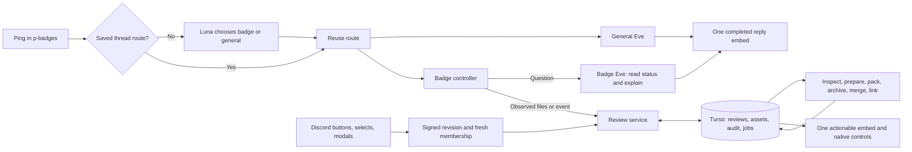
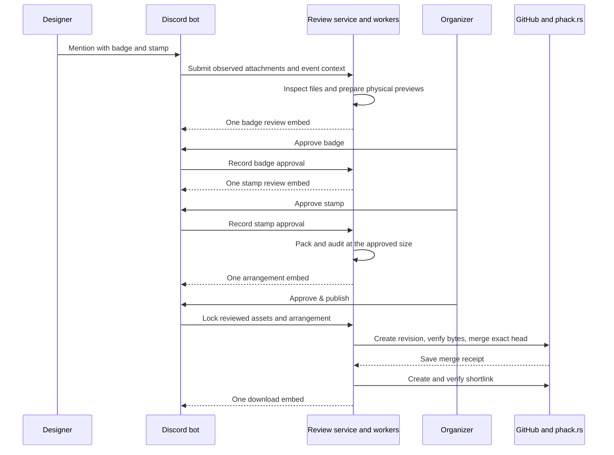

---
meta:
  contentType: Conceptual
---

# What happens after you submit a badge?

Mention wack hacker in #p-badges with your badge and stamp as Scalable Vector Graphics (SVG) files. The bot checks the files, presents each design for approval, then arranges the accepted badge. Each turn contains one embed and native Discord controls. Earlier messages stay unchanged.

## The four review turns

When the files and event are clear, you see four messages:

1. **Review the badge**: See the full badge, expected event and date, and physical dimensions. An organizer approves the version, date, readability, and strength together.
2. **Review the stamp**: See the finished impression and dimensions. An organizer approves the stamp or requests a specific change.
3. **Ready to publish**: See both cutting sheets in one image. An organizer selects **Approve & publish**, or you select **Try another layout** at the same size.
4. **Get the files**: Download the saved designs and sheets through `phack.rs/badge-<version>`.

**Request changes** opens a required feedback field. The next embed shows the feedback, full design, and an upload button. That button opens Discord’s native file upload modal. A stamp revision preserves badge approval. When a reviewer cannot read an image, the assistant suggests opening the full image or asking another reviewer; uncertainty alone does not require a revision.

## How the bot fills in the details

You only answer questions the submission leaves unresolved. The bot uses these sources:

- **Event**: An explicit Hack Night version or event link, then the saved thread selection. A native event selector resolves ambiguity. The content management system (CMS) supplies the exact version string and Indianapolis date.
- **File roles**: An explicit order such as “badge first, stamp second,” a requested replacement slot, or a role-specific upload button. Otherwise, one A/B image asks which design is the badge. Filenames do not assign roles.
- **Missing file**: One upload button asks for the missing badge or stamp. A requested revision from the original designer works without another mention.
- **Production settings**: Bot configuration supplies badge size, spacing, material, and sheets. Designers do not fill out a manufacturing questionnaire.

A mention replying to your own submission can use its attachments. A later explicit event reference can update the review’s event. Dates and versions apply to the badge, not the stamp.

## How chat reaches the workflow

The first mention in an unassigned #p-badges conversation calls `openai/gpt-6-luna-decisions` to choose the badge or general assistant. Redis stores the choice. Established threads and existing badge reviews bypass classification, including after restarts or Eve session resets.

The [Eve agent framework](./system/eve-policy-and-integrations.md) hosts the badge assistant separately. The controller handles uploads before starting an agent turn. Eve has one read-only workflow tool, `review_status`, for answering questions from current evidence. It cannot submit files, approve designs, change settings, or publish assets.

The architecture separates conversation, decisions, and delivery:

Both assistants use the existing [conversation delivery queue](./system/conversation-engine.md). In #p-badges, replies appear after completion without streamed prose or tool activity. A general assistant’s request for human input still uses native controls in one embed. Workflow uploads produce no separate agent acknowledgement.

## What approval covers

A design approval identifies that design’s bytes, relevant event details, physical size, and current standards. It does not depend on the other design or sheet positions. The final publication approval binds both designs, settings, manufacturing exports, and the selected arrangement.

These changes reopen only the affected work:

| Change                                                  | Review that must run again                            |
| ------------------------------------------------------- | ----------------------------------------------------- |
| Badge SVG, event details, badge size, or badge material | File preparation and badge approval, then arrangement |
| Stamp SVG                                               | File preparation and stamp approval, then arrangement |
| Positions, rotations, or spacing                        | Arrangement audit and publication approval            |
| Stamp source unchanged                                  | Existing stamp approval remains valid                 |

Permissions and revision checks run before a modal opens and again when it submits. Only the original designer uploads or identifies files. Organizers approve designs; any organizer can approve publication. Public metadata names the person who selects **Approve & publish**. Audit records retain the individual design decisions.

The service rejects stale controls privately and includes a jump to the latest message. Optimistic row versions reject competing mutations. Immutable assets and queued jobs live in the [Turso database](./system/storage-supervision-and-operations.md). Expiring job leases allow recovery; delivery receipts and stable Discord nonces deduplicate normal retries. Discord does not guarantee deduplication after its nonce window expires.

## Why arrangement comes after review

File inspection and physical preview preparation run before either approval. Packing starts only after both designs are accepted, and only rotates or translates the accepted badge.

The sequence keeps intermediate jobs silent:

Production settings live in [`policy.ts`](../packages/badges/src/policy.ts). The current defaults are a 2.2-inch badge long side, acrylic, and 0.2 mm between cuts. Exact event versions can override the badge size for unusual geometry. Sheets remain one 12 × 12-inch sheet and one 12 × 18-inch sheet, with 0.2-inch edges and a target of 80–100 badges.

The stamp always measures 1.5 inches on its shortest side and keeps its aspect ratio. A 3:1 stamp therefore measures 4.5 × 1.5 inches. The designer supplies unmirrored artwork. The review shows its unmirrored impression; the manufacturing export mirrors it once. Stamp material is separate from the badge sheets.

Packing uses a bounded rotation search and a separate contour audit for overlap, spacing, and edges. **Try another layout** varies orientations at the same size. If the search finds fewer than 80 badges, the bot reports that result without shrinking the design. An organizer can adjust configuration and select **Refresh review**; a changed size requires badge approval again. The search does not prove optimality or impossibility.

## What the checks establish

Current [Badge and Stamp Standards](https://app.notion.com/p/purduehackers/Standards-30b181f3b6ed81af8465cebbf43f1b2e) govern artwork. The stamp sizing and workflow rules above apply the approved production policy. Historical badges do not establish correctness, and this integration has no historical import mode.

Static checks cover vector artwork, outlined lettering, engraving fills, palettes, and one closed red cutting outline. Red cutting strokes are the exception to filled artwork. Inputs are limited to 1 MB and 5,000 elements. Scripts, external resources, raster images, entities, linked reusable objects, and stylesheets are rejected.

The cutter supports a simple exterior path with lines, quadratic curves, or cubic curves. Arcs and compound cuts require a plain-path export. Human review covers visual details, contrast, thin connections, artwork containment, and stamp clarity. No automatic close-ups or model visual approvals replace that review. Passing checks does not prove material strength or laser performance.

## How publication recovers

**Approve & publish** locks the selected revision. The worker checks current event and production settings, creates a GitHub pull request, and records its exact head. It verifies file bytes and changed paths, merges that head, and reads back the saved files before recording the merge receipt.

A separate job creates and verifies the live shortlink. If that job fails, the embed says the files are saved and offers **Retry link**. Retrying uses the stored receipt and does not merge again. Existing unrelated shortlinks are never overwritten.

New revisions can start in the same thread after publication. The previous public files remain available while the new revision is reviewed. Each publication generation gets its own branch. The shortlink points to the version directory on the repository’s default branch; Git history retains earlier revisions.

The directory includes original SVGs, physical SVGs, PNG previews, both sheet layouts, and metadata. Public metadata contains exactly `cms: { id, slug }`, `author: { id, username }`, and `reviewer: { id, username }`. The README contains the Hack Night title, badge image and download, then stamp image and download.

## When the feature is enabled

The bot enables this integration only when `BADGE_AGENT_URL` is configured. Deployment requires the separate badge Eve app, its own session namespace, the additive database migration, and CMS, GitHub, phack.rs, and model credentials. The badge app shares the existing Redis and Turso infrastructure. It stores bounded assets in Turso without requiring Vercel Blob.

The worker endpoint needs a 90s request timeout. The bot drains queued work after interactions and on its minute schedule. Typing indicators cover interactive work; only actionable states produce messages. The native SVG renderer remains an external build dependency.

Offline validation covers the four-message path, revisions, permissions, stale controls, concurrent decisions, stamp dimensions, packing limits, and partial publication. A local run in #p-wack-hacker also exercised badge approval, stamp feedback and native uploads, arrangement, repacking, and stale controls in Discord. That run used live CMS data and Luna routing with local storage; conversational Eve and publication were disabled. The [interaction review checklist](./plans/badge-review-copy.md) records the evidence and remaining live validation. This revision has not been deployed.
