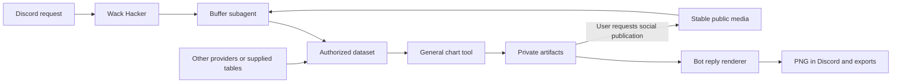

Wack Hacker: Buffer and charts
=============================

Plan approved November 15, 2026. Implementation is present in the workspace. Live reads verified the Afterhours organization and its three Purdue Hackers channels. The key is in ignored local configuration and Vercel secrets. Private/public Blob stores are connected, the additive database migration is applied, and a real-data PNG/SVG/CSV sample was delivered in `p-wack-hacker`. See [implementation and rollout status](../operations/buffer-and-charts.md) for validation and the coordinated rollout steps.

Build two capabilities: a native `buffer` provider subagent covering the entire documented public GraphQL API, and a general `render_chart` tool that any Wack Hacker workflow can use. Buffer supplies social data; the chart tool also accepts data from the CMS, finance, GitHub, or user-provided tables.

The public reference currently contains **24 queries and 25 mutations**. Include all 49, including preview and experimental operations. “Full API” means those operations, their complete inputs, nested metadata, pagination, and selectable output fields, subject to the account's permissions. It does not imply access to every feature in Buffer's website. [Buffer API reference](https://developers.buffer.com/reference.html)

Buffer's hosted MCP exposes a smaller, curated tool surface. Direct GraphQL fits this scope and Wack Hacker's existing provider authorization and audit path. The Eve registry search found third-party shell skills; the inspected package covers a smaller surface and is not a replacement for the native integration. [Buffer MCP documentation](https://developers.buffer.com/guides/integrations/mcp.html)

The complete operation inventory is:

| Skill                | Queries                                                                                                                    | Mutations                                                                                                                                                                                                |
| -------------------- | -------------------------------------------------------------------------------------------------------------------------- | -------------------------------------------------------------------------------------------------------------------------------------------------------------------------------------------------------- |
| Account and channels | `account`, `channel`, `channels`, `configuration`, `dailyPostingLimits`                                                    | —                                                                                                                                                                                                        |
| Publishing and queue | `post`, `posts`                                                                                                            | `createPost`, `editPost`, `deletePost`, `movePostInQueue`                                                                                                                                                |
| Metrics              | `aggregatedPostMetrics`                                                                                                    | —                                                                                                                                                                                                        |
| Ideas                | `ideaGroups`, `ideas`                                                                                                      | `createIdea`                                                                                                                                                                                             |
| Content items        | `contentItem`, `contentItems`                                                                                              | `createContentItem`, `createContentItemDraft`, `updateContentItem`, `updateContentItemDraft`, `promoteContentItemDraftToPosts`, `addPostToContentItem`, `removePostFromContentItem`, `deleteContentItem` |
| Notes and team       | `collaborationNotes`, `selectableTeamMembers`                                                                              | `createCollaborationNote`, `updateCollaborationNote`, `deleteCollaborationNote`                                                                                                                          |
| Tags                 | `tag`, `tagsV2`                                                                                                            | `createTag`, `updateTag`, `deleteTag`                                                                                                                                                                    |
| Templates            | `postTemplate`, `postTemplates`                                                                                            | `createPostTemplate`, `updatePostTemplate`, `deletePostTemplate`                                                                                                                                         |
| Snippets             | `snippets`                                                                                                                 | `createSnippet`, `updateSnippet`, `deleteSnippet`                                                                                                                                                        |
| Instagram audio      | `instagramAudio`, `instagramAudioCatalog`, `searchInstagramAudio`, `searchInstagramAudioCatalog`, `trendingInstagramAudio` | —                                                                                                                                                                                                        |

This inventory comes from the [machine-readable reference](https://developers.buffer.com/reference.md). Templates are preview features. Content items, notes, tags, snippets, audio, configuration, and queue movement include experimental features; retain their upstream status in tool descriptions and compatibility checks.

Publishing will cover drafts, immediate publication where supported, queue placement, exact scheduling, edits, deletion, and automatic or notification publishing. Preserve every supported network's metadata: threads, first comments, image tags, post formats, thumbnails, document assets, and other schema fields. Resolve natural-language local times in `America/Indiana/Indianapolis`, send explicit timestamps, and show the resolved time and channel in results. Read channel capabilities and post `allowedActions` before acting. Report API acceptance, scheduled state, successful delivery, and failure distinctly. [Posts and scheduling](https://developers.buffer.com/guides/posts-and-scheduling.html)

The current reference has no idea update/delete operations, channel connect/disconnect or schedule-edit mutations, comment/DM management operations, follower-history query, or webhook registration API. Configuration types mentioning engagement features do not establish callable operations. Show these limits accurately; expand coverage when public operations appear. OAuth onboarding for unrelated users is a separate product scope: this integration uses the supplied account credential.

Implement the provider under `packages/agents/agent/subagents/buffer/`, following the existing `agent.ts`, instructions, registry, tool definitions, skill definitions, runtime, and dynamic catalogs. Expose a small base discovery set and load the remaining tools through skills. Generate the domain README through the existing script.

Use one HTTP client with the fixed `https://api.buffer.com` endpoint, GraphQL variables, bounded request/response sizes, timeouts, and cursor pagination. Put the key in optional server-side `BUFFER_API_KEY` configuration; missing configuration produces the existing typed execution error. Add it to credential redaction and document only an empty placeholder in `.env.example`. Establish the intended organization during setup and configure the permitted organization IDs; check resource ownership when an operation accepts only a resource ID.

Maintain a versioned public-schema snapshot and a manifest mapping each root operation to its tool and policy. Obtain machine-readable schema through supported introspection if available; otherwise use the published reference to construct and validate the snapshot. Generate input types/schemas where practical, preserving GraphQL defaults and omitted-versus-null semantics. Each tool supports a validated response selection, with useful defaults and required identity/error fields, so uncommon nested fields remain reachable. The model does not receive an unrestricted HTTP or mutation bypass. A schema refresh must identify new operations and input fields, and a coverage check must fail if the reviewed schema contains an unrepresented operation.

Use `defineDomainTool`, `createDomainRuntime`, JSON serialization guards, and provider redaction. Explicitly set organizer access on Buffer reads and ordinary writes; set admin access and the existing destructive confirmation policy on deletions. Follow existing policy for publishing rather than adding a new blanket confirmation flow. Include operation identity and affected resource IDs in audit records. Recheck current authorization at execution time.

Handle HTTP failures, GraphQL `errors`, and mutation success/error unions independently. Preserve partial-success details, especially for content items. A timeout after a mutation is an uncertain result: reconcile the resource before retrying rather than risking a duplicate post. Use a durable local operation record for replay protection without claiming Buffer offers server-side idempotency. [Error handling](https://developers.buffer.com/guides/error-handling.html)

Track the provider's rate-limit windows and `Retry-After` responses. Budget concurrent requests across the deployment, cache stable account/channel metadata, and bound automatic pagination. Prefer server aggregates to retrieving every post when the question permits. [API limits](https://developers.buffer.com/guides/api-limits.html)

For graphing, add a general root tool, `render_chart`, backed by shared rendering and artifact libraries. It accepts structured data or an authorized dataset reference, a chart type, field mappings, labels, units, grouping, sorting, annotations, and a theme. Follow-up requests such as “make that weekly” reuse a saved chart specification and dataset. Provider subagents return dataset references to the root so large reports do not require the model to copy thousands of values.

Support line, bar, grouped/stacked bar, area, scatter, histogram, heatmap, and donut charts. Use a consistent PH theme with readable typography, restrained color, useful labels, mobile-friendly spacing, and light/dark variants. Include the period, source, timezone, and data freshness. Provide meaningful alt text and a short textual finding. Default to one clear chart; allow several related charts in one report.

Use **Apache ECharts** to render SVG on the server and **resvg** to produce PNG. ECharts supports SVG rendering without a browser; resvg supplies SVG rasterization. Prove the combination under Bun locally and the actual Eve deployment runtime before committing to dependency packaging. Bundle fonts so output does not depend on host fonts. [ECharts server rendering](https://echarts.apache.org/handbook/en/how-to/cross-platform/server/), [resvg](https://github.com/thx/resvg-js)

Keep rendering deterministic: translate a strict chart schema into library options, with no model-authored JavaScript, remote image loading, or arbitrary URLs inside the specification. Bound rows, series, dimensions, output bytes, and runtime. Compute aggregation and normalization in code. Preserve missing values; do not silently drop rows, invent values, sum percentages, or present a truncated dataset as complete. Keep the source data and chart specification with the artifact so a revision is reproducible.

The primary output is a **PNG attachment visible in Discord**, with SVG and CSV exports. An interactive browser report can be added later using the same chart specification; it is not necessary for the initial Discord workflow.

Use a private Vercel Blob store for generated PNG/SVG/CSV/specification files, with artifact metadata and ownership in the existing Turso database. The agent returns artifact IDs rather than local filesystem paths or base64. The bot resolves those IDs through an authenticated internal route and uploads the bytes to Discord. Configure access for both deployed processes; do not assume the bot container inherits the agent's Blob credentials. Give disposable artifacts a retention period longer than the seven-day render recovery window and allow reports to be retained. [Blob SDK](https://vercel.com/docs/vercel-blob/using-blob-sdk)

When a user asks to publish a generated chart, copy the selected image to a separate public media store and pass that stable URL to Buffer. Pin media while posts reference it and clean up only when those references permit it. Buffer does not accept file uploads, and the URL must remain reachable through publication. This also covers uploaded photos, videos, and documents used by Buffer tools. [Hosting media](https://developers.buffer.com/guides/hosting-media.html)

Wack Hacker currently accepts inbound attachments, but its outgoing `RenderIntent` and reply renderer carry text and controls. Extend the shared wire contract, artifact references in subagent results, the agent's render publisher, and the bot's REST/rendering path. Persist attachment hashes, Discord attachment IDs, and message IDs in the render projection. Retries, streaming edits, restarts, and finalization must retain attachments without uploading duplicates. Keep Discord writes in the existing bot renderer.

The resulting flow is:

Buffer reporting will include post performance, channel comparisons, campaign/tag summaries, publishing volume, and top-post rankings. Metrics require personal-key access and refresh roughly daily. Missing metrics are not zero; mixed-channel aggregates expose only common additional metrics. Aggregate requests have a 365-day limit, and sent-post history is retained for two years. Label metric timestamps and use per-channel queries when comparison requires metrics absent from mixed aggregates. [Post metrics](https://developers.buffer.com/guides/post-metrics.html)

Distinguish publication cohorts from observation history. “Current reactions on posts published each week” can be derived from available post data; it is not “reactions received during each week.” For genuine change-over-time charts, include an optional daily snapshot collector using the existing scheduler and Turso. Save observed values, source update timestamps, channel/post IDs, and collection status. It starts history when enabled and cannot manufacture earlier observations. Do not label post-attributed follows as total account follower growth. Per-post source values are available through paginated post queries. [Posts with metrics](https://developers.buffer.com/examples/get-posts-with-metrics.html)

Useful acceptance prompts include:

- “Show the queue for each channel and draft next week's posts.”
- “Schedule this announcement for Friday at 6 p.m. on our connected channels.”
- “Graph current reactions on posts published each week over the last three months.”
- “Compare these channels' top posts and show which metrics are available.”
- “Turn this attendance table into a bar chart.”
- “Make that chart dark, label the highest point, and export the data.”
- “Use this chart in a Buffer draft.”

Deliver the work in this order; all stages below are part of the proposed scope:

1. **Verify the contract and runtime.** Check account/channel access with reads, record the schema and 49-operation manifest, inspect entitlement limits, and prove SVG-to-PNG rendering and font packaging in the production build. Record unavailable experimental operations explicitly.
2. **Implement the Buffer foundation and reads.** Add configuration, client, schemas, policy, catalogs, all queries, pagination, metrics dataset exports, rate limiting, and typed failures. Verify exact operation coverage against the snapshot.
3. **Complete all mutations.** Implement publishing, ideas, content items, notes, tags, templates, snippets, and queue movement with full inputs, ownership checks, error unions, and replay handling. Exercise success and failure fixtures; reserve real publication tests for a designated test channel/post.
4. **Build shared charts and artifacts.** Add the strict chart API, deterministic transforms, theme, saved specifications, PNG/SVG/CSV generation, private storage, and explicit public-media publication.
5. **Deliver charts through Discord.** Extend the shared contract and bot renderer together. Verify attachment delivery, revisions, retry recovery, and persistence through a restart. Add optional snapshot/report scheduling support without enabling recurring jobs merely by deploying.
6. **Validate and document.** Generate the Buffer README, document environment/storage setup and upstream limitations, complete the checks below, and perform an end-to-end Buffer-data-to-Discord-chart check. Roll out compatible bot and agent versions together; keep attachment production disabled until both understand the new wire shape.

Expected code locations:

| Area                     | Changes                                                                                                                                                                                                             |
| ------------------------ | ------------------------------------------------------------------------------------------------------------------------------------------------------------------------------------------------------------------- |
| Buffer                   | `packages/agents/agent/subagents/buffer/`; a schema refresh/coverage script under `packages/agents/scripts/`                                                                                                        |
| Configuration and policy | `packages/agents/agent/env.ts`, `.env.example`, `packages/agents/agent/lib/policy/provider-redaction.ts`                                                                                                            |
| Charts                   | `packages/agents/agent/tools/render_chart.ts`, shared chart/artifact libraries, `packages/agents/agent/lib/descriptors.ts`, core tool authorization                                                                 |
| Artifact delivery        | `packages/shared/src/wire.ts`, `packages/shared/src/conversations/records/render.ts`, `packages/agents/agent/lib/subagent-output.ts`, `packages/agents/agent/channels/discord.ts`, `packages/bot/src/agent/render/` |
| Persistence and jobs     | Existing shared Drizzle schema/migrations, private artifact routes, root-level Eve schedules                                                                                                                        |
| Documentation            | Generated Buffer README, package capability counts, setup and operations documentation                                                                                                                              |

Required validation during implementation: `bun run lint` with `--deny-warnings` intact; `bunx oxfmt --check .`; the agent package's `bun run check:capabilities`, `bun run check:serialization`, and `bun run build`; and `bun test` for new behavior tests. Focus tests on authorization, pagination completeness, partial mutations, ambiguous retries, metric semantics, artifact access, and renderer recovery. Visually inspect representative charts with long labels, sparse dates, missing values, many categories, and both themes. Use read-only live checks for integration setup; distinguish simulated mutation coverage from actual live-write verification.

Completion means every documented operation is reachable under the appropriate policy, full inputs and nested fields are supported, charts work with Buffer and another data source, PNGs render in Discord, SVG/CSV exports open correctly, and a bot restart does not duplicate or lose attachments. Unsupported account features must produce a clear capability error, never a success-shaped empty result.
